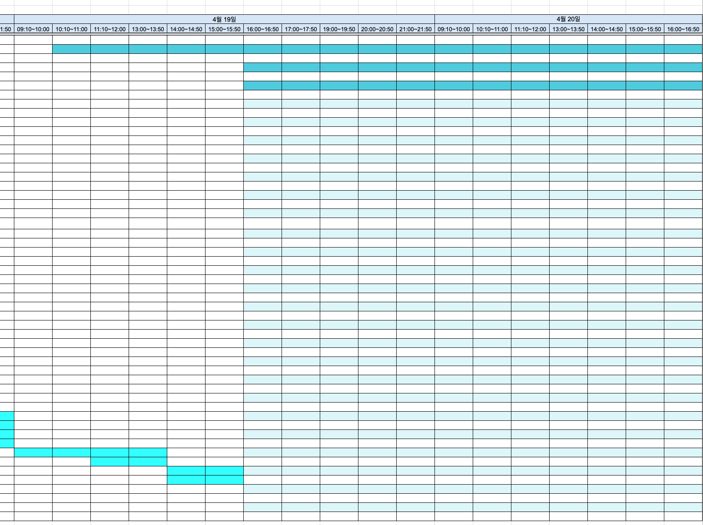
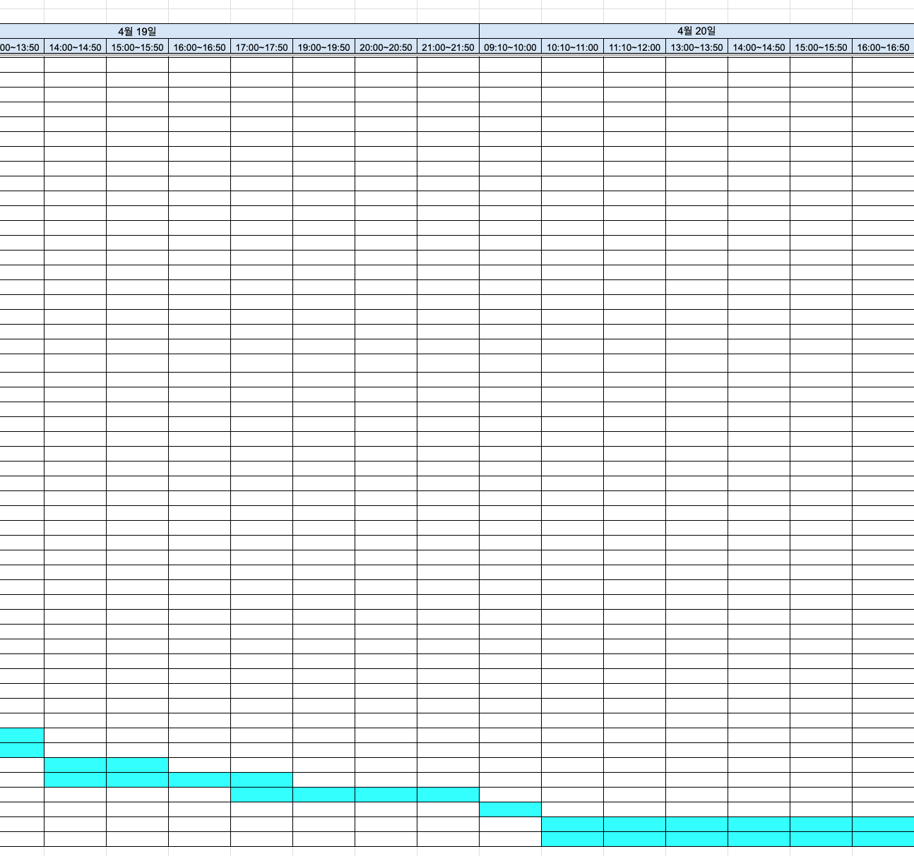

# clear-spreadsheet

Removes the table and theme background colors that Google Sheets shows on an `.xlsx` file, and keeps the cell colors you set by hand. Useful for schedules and trackers where cell colors carry meaning.

## Usage

```bash
./setup.sh
./run.sh /path/to/file.xlsx
```

Without the virtualenv wrapper:

```bash
python3 clear_spreadsheet.py /path/to/file.xlsx
```

The output is `filename.cleaned.xlsx` next to the input.

Example:

```bash
./run.sh ~/Downloads/your_file.xlsx
```

Output:

```text
Done.
Output file: /Users/you/Downloads/your_file.cleaned.xlsx
Removed theme/table artifacts: 6 parts, 4 table links, 8 theme color refs
```

It can also be installed as a package through `pyproject.toml`.

## Windows EXE

On Windows, a standalone `.exe` is available.

- Drag `.xlsx` files onto the app window or onto the `.exe`
- Each cleaned file is saved next to the original as `filename.cleaned.xlsx`

Build it on Windows:

```bat
build_windows_exe.bat
```

Install Python 3 first if it is missing:

```powershell
winget install -e --id Python.Python.3.12 --accept-package-agreements --accept-source-agreements
```

The batch file installs the dependencies in `requirements-build.txt` and creates:

```text
dist\clear-spreadsheet.exe
```

Drag-and-drop uses `tkinterdnd2`; `hook-tkinterdnd2.py` is its PyInstaller hook.

## Before and After

### Before

Google Sheets applies the hidden `theme` and `table style`, so stripes and background colors show over the hand-set cell colors.



### After

Only the hand-set cell colors remain.



## Why this happens

- Hand-set colors are stored in the cell `fill`.
- Excel table banding is stored in `tableStyle` and `tableParts`.
- Some colors are stored as `theme` indexes instead of RGB values.
- Google Sheets draws this table and theme styling, which Excel barely shows.

## What this tool does

- Converts `theme` color references into explicit `rgb` values
- Removes Excel `table` definitions and `table style`
- Removes banding driven by `showRowStripes` / `showColumnStripes`
- Removes Google Sheets round-trip metadata

## What it keeps

- Explicit cell background colors
- Cell values
- Merged cells
- Column widths / row heights
- Most worksheet / drawing structure

## Options

Set the output filename explicitly:

```bash
python3 clear_spreadsheet.py input.xlsx --output output.xlsx
```

Change the default suffix:

```bash
python3 clear_spreadsheet.py input.xlsx --suffix fixed
```

Overwrite the original file in place:

```bash
python3 clear_spreadsheet.py input.xlsx --in-place
```

Overwrite an existing output file:

```bash
python3 clear_spreadsheet.py input.xlsx --overwrite
```

## Limitations

- Only `.xlsx` is supported right now.
- Check the result by eye if the workbook has theme-colored charts or shapes.

## License

MIT

## Test

```bash
python3 -m unittest discover -s tests
```
